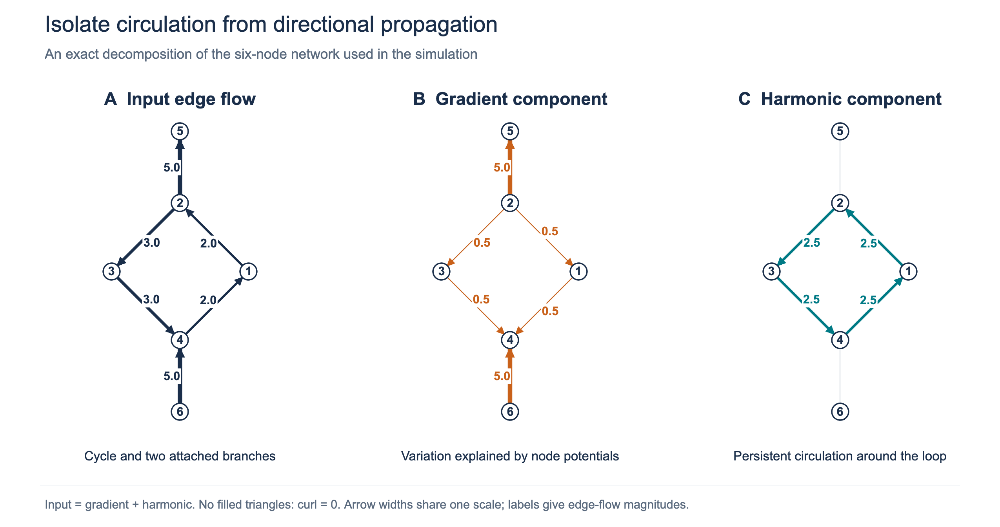
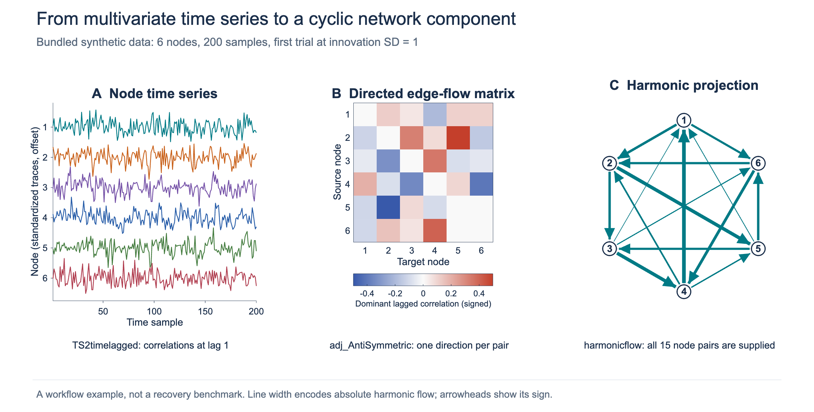
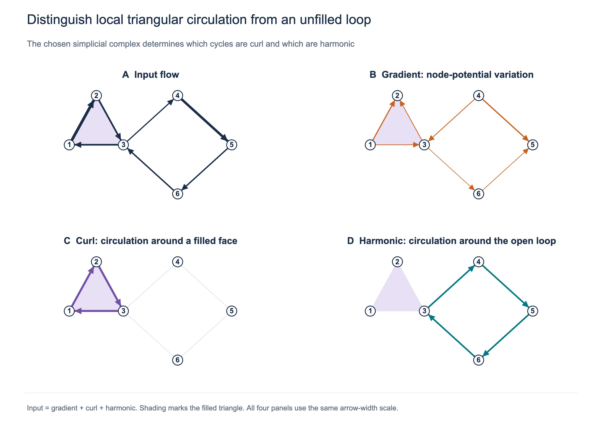

# Harmonic flows: Hilbert Space Theory of Cycles

**MATLAB tools for extracting cyclic structure from directed network flows.**

Brain networks contain recurrent interactions that are difficult to summarize one connection at a time. This package represents directed interactions as edge flows and uses harmonic projection to isolate their cyclic component. It provides MATLAB functions, worked simulations, and comparisons with other methods for estimating directed interactions.

<p align="center">
  
  
  
</p>

*The existing animations show time-varying harmonic streamlines for three subjects, viewed from above. They illustrate how cyclic brain-network flow is organized across space and changes over time.*

## What the package can do

| Task | What it provides | Main functions |
| --- | --- | --- |
| **Simulate recurrent networks** | Generate node time series from a directed network with known cyclic structure; explore the supplied strong- and weak-circulation simulations. | `VAR_graph` |
| **Construct directed edge flows** | Compute time-lagged correlations over one or more windows and encode a direction for each node pair. | `TS2timelagged`, `adj_AntiSymmetric`, `adj2edgeflow` |
| **Extract harmonic circulation** | Project an edge flow onto its cyclic component and return both an edge vector and an antisymmetric connectivity matrix. | `harmonicflow`, `harmonic` |
| **Separate types of network flow** | Decompose flow into gradient, curl, and harmonic components on a chosen simplicial complex. | `adj2simplex`, `PH_boundary`, `Hodge_decompose_edgeflow` |
| **Explore comparison methods** | Run the included VAR/Granger, nonlinear SEM, transfer entropy, constraint-based cyclic discovery, and NOTEARS implementations. | `VAR_fit`, `SEM_nonlinear`, `TE`, `CCD`, `CCD_R`, `NOTEARS`, `VAR_score` |
| **Visualize results** | Display directed networks, edge strengths, and node time series. | `graph_directed_plot`, `graph_overlay_timeseries`, `flow2matrix` |

The main walkthrough is [SIMULATION-causality.mlx](SIMULATION-causality.mlx). The repository includes the same simulated time-series realizations for use across methods: [strong circulation](simulationZ_strongcirculation.mat) and [weak circulation](simulationZ_weakcirculation.mat), each with 100 trials at three innovation standard deviations.

## What harmonic projection reveals



**Separate circulation from propagation.** In this synthetic example, the input contains a four-node cycle and two attached branches. The gradient component captures variation explained by node potentials. The harmonic component removes the branches and retains a circulation of 2.5 around the loop. Arrow widths use the same scale in all three panels.



**Connect time series to network structure.** A stored simulation trial is converted to lagged correlations, then to a directed edge-flow matrix and its harmonic projection. This example supplies all 15 node pairs; it does not use the known generating edges to select connections. It illustrates the workflow rather than a recovery benchmark.



**Distinguish local and global circulation.** A filled triangle supports a curl component, while the unfilled four-edge loop supports harmonic circulation. The decomposition satisfies **input = gradient + curl + harmonic**. The `harmonicflow` and `harmonic` wrappers use an edge-only graph, where curl is zero; use the lower-level functions with triangle faces when the three-component decomposition is needed.

All three static figures were computed and rendered in MATLAB using this repository's functions. [Figure methods and reproduction instructions](assets/readme/FIGURES.md) document their inputs and numerical checks.

## Get started

Download or clone the repository, open its folder in MATLAB, and run:

```matlab
addpath(pwd)
open('SIMULATION-causality.mlx')
```

Run the sections of interest together with the preceding sections that define their inputs. The full comparison study contains repeated simulations and can take substantially longer than a single example.

For a minimal projection from a supplied time-series trial:

```matlab
D = load('simulationZ_weakcirculation.mat');
Z = D.Zall(:,:,2,1);                         % nodes x time
TL = TS2timelagged(Z.',1,size(Z,2)-1,1);      % lag-1 correlations
A = adj_AntiSymmetric(TL);
Edges = nchoosek(1:size(Z,1),2);              % lexicographic node pairs
X = A(sub2ind(size(A),Edges(:,1),Edges(:,2)));
out = harmonicflow(X);
H = out.connectivity;                       % antisymmetric harmonic matrix
```

`harmonicflow` expects one value for every unordered pair in lexicographic order, with `p*(p-1)/2` entries for `p` nodes. For a specified sparse edge set or a complex with faces, use `Hodge_decompose_edgeflow` with the matching boundary matrices.

**Requirements:** MATLAB. Comparison functions using `fitrgam`, `fcdf`, and `tiedrank` require the Statistics and Machine Learning Toolbox. The README examples were run in MATLAB R2026b.

## Scientific basis

Harmonic projection provides a representation of recurrent network structure for studying brain connectivity and other dynamical systems. Its interpretation depends on the input interaction measure and the selected graph or simplicial complex. The research papers develop the theoretical and statistical framework:

- Chung, M.K., Anand, D.V., El-Yaagoubi, A.B., Jung, J.-H., Qiu, A., and Ombao, H. (2026). [Causality as a Minimum Energy Principle](https://arxiv.org/abs/2604.17151). *IEEE EMBC 2026*, pp. 1–5. [Presentation slides](2026.07.27.EMBC.causality.minimumenergy.pdf).
- Chung, M.K., El-Yaagoubi, A.B., and Ombao, H. (2026). [Vector Space of Cycles](https://arxiv.org/abs/2606.08202). [OHBM 2026 poster](chung.2026.OHBM.pdf).

Please cite the relevant papers when using the methods. The underlying Hodge routines originate from the [Hodge Laplacian library](https://github.com/laplcebeltrami/hodge).

## Development

This is research software under active development. The Live Script and comparison functions provide worked implementations for methodological exploration. Suggestions and reproducible bug reports are welcome through [GitHub Issues](https://github.com/laplcebeltrami/harmonic/issues).

© 2026 Moo K. Chung, University of Wisconsin–Madison.
